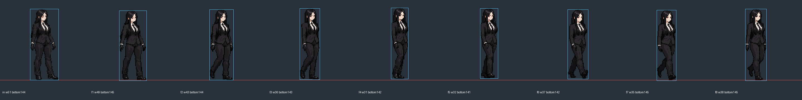

# PixelLab 보고서에 대한 Claude 검토

작성일: 2026-10-20. 대상: `codex/jyaldi-consolidation` 브랜치의 `docs/JYALDI_PIXELAB_REVIEW_REPORT_2026-10-20.md`(커밋 06c6d21)와 `game-src/action/pixellab-trial/`.
이 문서는 검토다. 새 그림 승인이나 결제 권유가 아니다.

## 1. 결론

- 보고서는 정직하게 쓰였다. 철회한 견적, 미시험 기능, 기능 시험과 시각 합격의 구분이 정확하다. 보고서 내용 중 사실과 다른 부분은 찾지 못했다.
- PixelLab 걷기 시험의 가장 큰 결함은 **몸이 도는 것**이다. 보고서가 "몸통이 정면 쪽으로 돌아간다"고 적었지만 프레임을 재 보면 반대다. 3/4 시점 입력(폭 51px)에서 시작해 3~5프레임에서 거의 옆모습(폭 31px)으로 돌았다가 7~8프레임에서 다시 3/4로 돌아온다. 반복 재생하면 매 주기 몸을 비틀었다 펴는 것처럼 보이고, 사용자가 말한 "매끄럽지 않다"의 주원인으로 판단한다.
- 원인은 입력 그림과 요청의 충돌로 본다. 입력은 정면에 가까운 3/4 차렷 자세인데 요청은 "facing right 걷기"다. 모델이 걷기 쪽을 따르며 옆모습으로 돌아갔다. 프롬프트로 "turning 금지"를 넣어도 막지 못했다.
- 그래서 다음 시험보다 먼저 **게임 화면 시점 하나를 정하는 것**이 필요하다. 모든 동작이 같은 시점에서 그려져야 통일성이 생긴다. 이것은 PixelLab 여부와 상관없는 기준표 문제다.

## 2. 걷기 프레임 실측

| 프레임 | 입력 | 1 | 2 | 3 | 4 | 5 | 6 | 7 | 8 |
|---|---|---|---|---|---|---|---|---|---|
| 그림 폭(px) | 51 | 49 | 43 | 36 | 31 | 32 | 37 | 35 | 38 |
| 발 아래끝(y) | 144 | 145 | 144 | 143 | 142 | 141 | 142 | 145 | 145 |

- 폭 51→31→38은 팔 흔들림이 아니라 몸 회전이다. 어깨 폭과 가슴 방향이 함께 바뀐다.
- 발 아래끝이 141~145로 4px(화면 8px) 오르내린다. 걷기에서 발 들림은 자연스럽지만, 디딤발이 바닥에서 뜨는 프레임(4·5)은 접지 오류다. 자동 정렬하지 말고 디딤발 기준으로 판정해야 한다는 보고서 판단에 동의한다.
- 8프레임 → 1프레임 연결이 끊긴다(폭 38→49). 반복 보행이 아니라 "돌아서 걸어가다 다시 돌아오는" 한 번짜리 동작이 됐다.
- 6프레임은 두 다리가 X자로 교차한다(모델 워킹). 일상 보행 요청과 다르다.
- 팔 흔들림은 거의 없다. 사용자가 반려했던 "팔 고정" 문제가 그대로 남아 있다.
- 얼굴·머리 크기·복식·팔레트는 입력과 잘 맞는다. **같은 인물 유지는 이전 v4보다 확실히 낫다.** 이 점이 사용자의 "훨씬 낫다" 평가와 일치한다.

## 3. 기준표(production-v5 master-source)에 대한 의견

- 정면·옆·3/4의 얼굴과 복식은 일관되고 원작 특징(긴 흑발, 붉은 눈, 검은 정장, 흰 셔츠, 검은 넥타이, 장갑)을 지켰다.
- 다만 이 기준표는 사용자 승인을 받지 않은 후보다. 걷기 입력으로 쓰기 전에 **게임 시점의 정자세 한 장**을 따로 승인받는 단계가 빠졌다.
- 3/4 그림은 상체가 정면, 발은 옆을 향해 있어 몸 방향이 섞여 있다. 이 상태로 동작 생성에 넣으면 이번처럼 모델이 방향을 스스로 고른다.

권고: 벨트스크롤 게임 시점을 "오른쪽을 보는 옆모습에 가까운 3/4(가슴은 약간 보이고 어깨선은 거의 옆)" 하나로 정한다. 그 시점의 정자세 128px 한 장을 사용자에게 먼저 승인받고, 이 한 장을 모든 동작의 입력으로 쓴다. 정면·뒷모습은 컷인·대화용으로만 쓴다.

## 4. 동작 수 다시 세기 (보고서 12장 첫 항목)

기준서(`docs/JYALDI_PRODUCTION_STANDARD.md`) 3·4장은 계열이 28개이고 전환까지 펼치면 200개가 넘어 보인다. 대부분은 공용 클립으로 묶인다.

| 묶음 | 실제로 따로 그릴 클립 | 공용으로 해결 |
|---|---|---|
| 대기 | 기본 대기, 전투 대기 | 방향 전환은 좌우 반전 + 1~2프레임 |
| 이동 | 걷기, 달리기, 뒤걸음 | 출발·정지는 반복 클립의 접촉 자세 1장씩; 횡이동은 걷기 재사용 |
| 낮은 자세 | 앉기(내려가기), 앉아 이동, 하단차기 | 일어서기 = 앉기 역재생; 바닥 조사·낮은 줍기 = 앉기 + 손 1장 |
| 점프 | 준비, 상승·정점·낙하(3장), 착지, 공중차기 | 이동 점프는 같은 그림; 공중 사격은 권총 상체 1장 |
| 근접 | 잽, 스트레이트, 강타, 대시공격 | 반격 = 강타 재사용; 연계 중단 복귀 = 전투 대기 진입 2장 |
| 권총 | 꺼내기, 조준·사격(반동 포함), 재장전 | 수납 = 꺼내기 역재생; 이동 사격은 1차에서 제외 권장 |
| 피격·다운 | 약 피격, 강 피격·날아감, 바닥 충돌·누움, 기상 | 잡힌 반응·스턴·공중 피격·벽 충돌은 이 넷을 조합 |
| 방어·회피 | 가드(진입·유지), 가드 피격, 회피, 슬라이드 | 가드 해제 = 진입 역재생 |
| 능력·필살 | 파쇄장 충전·방출, 필살 방출, 컷인 | 지면·상향·후방 파괴는 효과(이펙트)로 차별화 |
| 일상 | 문·단말기·보급함 조작(한 손 앞 조작 1종), 말하기, 의자 앉기, 섭취(먹기·마시기 2종) | 통신기 = 말하기 + 소품; 줍기·전달 = 앞 조작 변형 |

이렇게 묶으면 **쟈알디 한 명의 실제 고유 클립은 약 40~45개**다. 이 중 첫 플레이 가능한 전투판에 필요한 것은 약 20개(대기 2, 걷기, 달리기, 점프 3장, 앉기·앉아 이동·하단차기, 근접 3+대시, 사격, 피격 2, 다운·기상, 회피)다. 잡기·잡힌 반응·재장전 세부·일상 동작은 두 번째 단계로 미루기를 권한다.

## 5. 비용 다시 세기

보고서의 계산식(`ceil(폭×높이×프레임/65536)`, 160×160×8 = 4)은 실측 1회와 맞는다. 이 식을 그대로 쓴다고 가정하면:

- 1단계 20클립 × 평균 8프레임 × 160×160 = 20×4 = **80 생성량 (1회씩)**. 시도 3회로 잡아도 240.
- 전체 45클립 = 180, 시도 3회로 잡아도 약 540. 넓은 공격(192×160 = 4)·점프(160×192 = 4)도 같은 단가다.
- 결론: 월 2000(Apprentice)이면 쟈알디 한 명 전체를 여러 번 시도할 수 있다. 보고서의 "수천 단위 철회"는 옳다.
- 단, "시도 3회"는 아직 근거가 없다. 표본은 1회뿐이고 그 1회는 불합격이다. 진짜 비용은 합격률이 정하며, 그 값은 아래 6장의 시험으로 얻어야 한다.

캔버스 줄이기: 걷기·대기처럼 좁은 동작은 96×144로 줄이면 8프레임 2생성량이다(현재 4). 그러나 (1) 직사각형·작은 캔버스를 animate_image가 받는지, (2) 여백이 줄면 결과가 나빠지는지 확인되지 않았다. 128px 본체를 줄이지 않는다는 원칙은 유지하고, 캔버스 축소는 시험 한 번으로 확인한 뒤에만 쓴다. 지금 단계에서 아낄 수 있는 양(클립당 2)은 작으므로 우선순위는 낮다.

## 6. 남은 체험량 36으로 할 시험 (권고 순서)

한 번에 변수 하나만 바꾼다. 각 시험은 같은 걷기, 같은 seed, 같은 프레임 수.

1. **입력 시점만 바꾸기 (4)**: 기준표에서 새로 만든 "옆모습에 가까운 3/4" 정자세를 입력으로, 나머지는 이번과 동일. 몸 회전이 사라지는지 본다. 이 입력 그림을 만드는 비용은 별도다(Pro 생성 10~25로 안내됨, 실측 아님).
2. **첫·끝 자세 지정 (4)**: 1의 입력에 마지막 기준 이미지 = 접촉 자세를 지정. 반복 이음이 좋아지는지 본다. 정자세를 끝 이미지로 넣으면 매 주기 멈추므로 접촉 자세를 써야 한다는 보고서 지적에 동의한다.
3. **등록 캐릭터 + 걷기 템플릿**: 비용이 안내와 다를 수 있으니 실행 전 예상 차감을 기록하고, 남은 양이 부족하면 하지 않는다. 템플릿은 동작 간 같은 인물 유지에 유리할 가능성이 있지만 이 캐릭터로 검증되지 않았다.
4. **뼈대 v3 (8프레임 3)**: 걷기 보폭·팔 흔들림을 좌표로 강제할 수 있는 유일한 방법이다. 걷기에서 팔이 계속 안 움직이면 이 방식을 우선 검토한다. 다만 18관절 좌표를 누가 어떻게 만드는지가 실제 작업량이다.

판정 기준(매 시험 공통): 몸 폭 변화가 팔·다리 위치로 설명되는가, 디딤발이 바닥선에서 뜨지 않는가, 8→1 이음, 팔이 어깨에서 반대 다리와 교차하는가, 머리 크기 동일. 사용자 평가가 최종이다.

## 7. 시연판·코드 쪽 지적

- 시연판은 프레임을 같은 간격으로 돌리고 한 주기 이동량을 200으로 임시 설정했다(보고서 7.2). 걸음 수와 이동이 안 맞으면 발이 미끄러져 보이는데, 이것도 "매끄럽지 않다"의 원인 일부일 수 있다. 디딤발의 x 이동량을 프레임에서 재서 한 주기 이동량을 맞추면 생성량 없이 개선된다. 이건 무료 작업이므로 다음 시험 전에 먼저 해 둘 것을 권한다.
- `codex/jyaldi-consolidation` 브랜치에는 보고서 외에도 `sim.ts` 160줄, 테스트, 시연판 3개, PNG(합계 약 14MB)가 있고 main에 합쳐지지 않았다. 합칠 때 그림 파일은 반려·후보 표시를 유지하고, 게임 팩에 들어가지 않는지 확인해야 한다.
- 보고서 8.2의 16프레임 열(예: 160×160 = 7)은 `ceil` 계산상 맞다. 다만 16프레임이 animate_image에서 가능한지는 보고서도 확인하지 않았다.

## 8. 정리: 검증된 것 / 실패한 것 / 다음

- 검증됨: PixelLab MCP 연결·생성·적용; 160×160×8 = 4 차감; 생성 결과가 입력 인물의 얼굴·복식·팔레트를 지킴.
- 실패: 반복 걷기(몸 회전, 8→1 이음, 팔 흔들림 부족, 디딤발 뜸).
- 미검증: 시점을 맞춘 입력의 효과, 템플릿·뼈대 방식, 직사각형 캔버스, 동작 간 인물 유지, 합격률.
- 다음: ① 게임 시점 정자세 1장 사용자 승인 → ② 시연판 이동량을 디딤발에 맞춤(무료) → ③ 6장 시험 1·2 → 결과로 템플릿·뼈대 시험 여부 결정. 결제는 ③ 결과 뒤에 판단.

## 9. Claude 직접 시험 결과 (2026-10-20, 잔액 36 → 22)

생성은 Claude가 PixelLab MCP로 했다. 그림을 손으로 고치지 않았다. 자료: `game-src/action/pixellab-trial2/` (`log.json`에 요청문·job·차감 기록). 시연판: `release/demo/jyaldi-pixellab-walk-trial2.html`. 모두 미승인 후보다.

| 단계 | 도구 | 차감 | 결과 |
|---|---|---|---|
| 게임 시점 대기 자세 후보 | `edit_image_pro_flash` 글 편집 (입력: v5 기준표 3/4를 128px로 줄인 것, GPT 시험과 같은 입력) | 6 | 옆모습에 가까운 3/4, 발끝 오른쪽, 키 130px. 넥타이·셔츠가 거의 가려짐 |
| 걷기 시험 1 (6장 시험 1) | `animate_image`, 입력만 바꿈, 요청문·seed 동일 | 4 | **몸 회전 사라짐.** 그러나 1~5장은 제자리 출발처럼 보폭이 작고 6~8장에서야 걸음이 커짐. 8→1 이음 끊김 |
| 걷기 시험 2 (6장 시험 2 변형) | `animate_image`, 시험 1의 7장(접촉 자세)을 첫·끝 이미지로 고정 | 4 | **반복 보행이 이어짐.** 8장이 입력과 범위가 같음. 디딤발이 한 장마다 9px씩 일정하게 뒤로 밀림(양쪽 반주기 모두). 디딤발 바닥 142~143, 1px 차이 |

남은 결함(시험 2):
- 팔 흔들림이 약하다. 손이 대부분 엉덩이 옆에 붙어 있고 7~8장에서만 조금 보인다. "팔이 어깨에서 반대 다리와 교차" 기준은 미달.
- 검은 바지라 어느 다리가 앞인지 접촉 자세(1·4장)에서 구분이 약하다. 좌우 교대가 실제로 일어나는지 눈으로 확인 필요.
- 대기 자세 후보에서 흰 셔츠·넥타이가 줄어 원작 특징 일부가 약해졌다.

시연판은 이동 속도를 디딤발 실측(9px/장, 8장 72px, 초당 8장)에 맞췄다. 바닥 눈금이 캐릭터와 함께 흐르므로 발 미끄러짐을 볼 수 있다.

다음 후보(사용자 판단 후): 팔 흔들림이 계속 문제면 6장 시험 4(뼈대 v3, 8장 3)로 팔 위치를 좌표로 강제하는 것이 유일한 직접 수단이다. 대기 자세가 승인되면 같은 자세로 달리기 1회(4)를 먼저 시험해 방식이 다른 동작에도 통하는지 본다.

### 9.1 달리기·첫 타 (잔액 22 → 10)

| 단계 | 방식 | 차감 | 결과 |
|---|---|---|---|
| 달리기 열기 | 대기 후보에서 시작 | 4 | 걷기 시험 1과 같은 양상: 1~5장은 출발, 6~8장에서 팔을 크게 흔들며 달림 |
| 달리기 반복 | 위 7장을 첫·끝으로 고정 | 4 | 반복 이어짐(8장 = 입력 범위). **팔이 어깨에서 반대 다리와 크게 교차.** 디딤발 18px/장. 단, 두 번째 디딤 반주기의 발 바닥이 139로 첫 반주기(142)보다 3px 높음(화면 6px) |
| 첫 타(잽) | 대기 후보를 첫·끝으로 고정 | 4 | **한 번에 대기→가드→뻗기→복귀→대기.** 뻗은 장이 5장 하나뿐이라 시연판은 그 장을 3배 길게 보여 줌. 뻗은 주먹 끝이 작고 납작함 |

결론: "열기 생성 → 접촉/보폭 장면을 첫·끝으로 고정"은 반복 동작(걷기·달리기)에, "대기를 첫·끝으로 고정"은 단발 동작에 통했다. 실측 단가: 반복 동작 8, 단발 동작 4. 남은 결함은 달리기 두 번째 반주기 발 뜸, 걷기 팔 흔들림 약함, 잽 주먹 형태.
