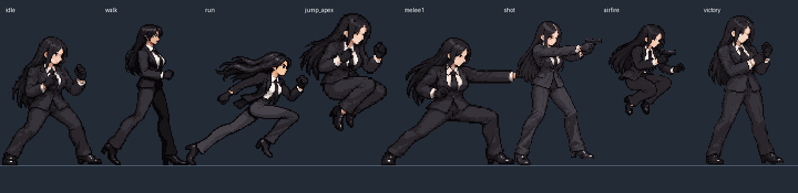

# 다음 방 작업 인계 — 캐릭터 이미지 전면 재제작

갱신: 2026-10-20. 이 문서를 먼저 읽는다. 사용자는 이 방의 제작을 중단하고 다른 방에서 이어가도록 지시했다. **현재 그림은 동작마다 다른 인물처럼 보이는 중대 결함으로 반려됐다. 기존 캐릭터 이미지를 재활용하지 말고, 모든 동작을 통일성 있게 새로 그리라는 명시적 지시가 최우선이다.**

## 1. 마지막 사용자 지시 — 해석으로 완화하지 말 것

- 다른 방에서 기존 이미지 재활용을 못 하게 할 것.
- 캐릭터를 전부 통일성 있게 다시 그리게 할 것.
- 지침을 최신화하고 바로 이어받을 수 있는 상태로 저장소에 남길 것.

여기서 전면 재제작은 동작별로 서로 다른 인물을 다시 생성하라는 뜻이 아니다. **하나의 확정된 캐릭터 디자인·신체 구조·복식·도트 표현을 기준으로 전체 행동을 새로 제작**해야 한다. 새 제작 과정에서 통일된 신규 기준표와 신규 핵심 자세를 반복 참조하는 것은 필수다. 금지하는 재활용은 이번에 반려된 기존 그림의 재사용이다.

### 기존 이미지 재사용 금지 범위

쟈알디를 비롯한 기존 캐릭터의 원본·샘플·스프라이트·동작 시트·컷인·프레임을 신규 제작물에 사용하지 않는다. 우선 작업 대상은 쟈알디의 모든 본체 동작과 캐릭터 컷인이다. 이후 다른 요원과 NPC도 기존 그림이 있다는 이유로 승인된 자산으로 취급하지 않는다.

다음 경로는 **반려된 과거 기록**이다. 새 캐릭터의 원본·편집 입력·트레이싱 바탕·완성 프레임으로 사용하지 않는다.

- `game-src/action/normal-v3/` 전체 캐릭터 원본 및 `normal-v4/`의 캐릭터 WebP 전체.
- `game-src/action/jyaldi-master.png`, `game-src/action/jyaldi-motions.png`, `game-src/actor9-jyaldi.png`.
- `game-pack/action/a-jyaldi-action.png`, `game-pack/action/jyaldi-master.png`, `game-pack/patrol/a-jyaldi.png`.
- `release/demo/samples/`의 기존 쟈알디 캐릭터 샘플.
- 기존 HTML과 그림 팩에 내장된 같은 그림, 생성 이미지 디렉터리에 남은 이전 후보, 과거 늘씬한 버전.
- 기존 C/S 본체와 컷인도 예외가 아니다. v4에서 남겨 쓴 v3 그림 60개를 그대로 유지하는 방식 금지.

크기·배율·팔레트만 변경하기, 머리·몸통·손발을 잘라 조립하기, 부위 길이를 늘이거나 줄이기, 기존 그림 위에 덧칠하기, 일부 프레임만 교체하고 나머지를 섞기 모두 전면 재제작으로 인정하지 않는다. 새 프레임을 생성하는 도구의 참조 이미지로 반려된 기존 시트를 넣는 것도 금지한다. 기존 이미지는 **결함 확인·비교·회귀 검수 목적의 열람만 허용**한다.

사용자가 제공한 **원작 레퍼런스 원화**와 반려된 게임 도트는 구분한다. 원작 원화는 인물 정체성의 참고로 쓸 수 있다. 외부 튜토리얼과 적법한 자료는 동작·도트 원리 분석에 활용할 수 있다. 무료 에셋을 그대로 쟈알디라고 붙여 넣는 것으로 새 제작을 대체하지 않는다.

배경은 이번 캐릭터 재사용 금지의 직접 대상이 아니다. 다만 캐릭터를 배경에 맞춘다고 체격을 왜곡하지 않고 원근·소품 크기·접지를 함께 검수한다. 파일 삭제는 요청받지 않았으므로 과거 기록은 보존한다. 코드·물리·입력·테스트·패킹 도구는 재사용 가능하지만 그림 교체 후 전환·판정·앵커를 다시 검증한다.

## 2. 반려 사유 — 같은 실패를 반복하지 말 것



이 비교는 현행 런타임의 실제 프레임을 모두 같은 2배 배율로 배치한 결함 확인 자료다. 새 디자인 시트가 아니다.

- 기본 대기·공격·걷기·달리기·점프·총격에서 얼굴, 머리 크기와 형태, 흉곽·허리·골반, 팔다리 두께와 길이, 의상 표현이 달라진다.
- 걷기는 가늘고 긴 몸통, 공격은 다른 매스, 점프는 큰 머리와 상체, 사격은 또 다른 체격으로 보인다. 자세 변화로 설명할 수 없는 차이다.
- 개별 시트 생성 후 키와 배율을 맞추는 것을 캐릭터 통일성 검수로 대신했다. 이 접근이 실패했다.
- v4에서 59개 신규 그림과 60개 구형 그림 및 기준 포즈 1개를 혼합했다. 시간표·판정 개선이 있어도 인물 불일치를 해결하지 못했다.
- 사용자의 “아까보다는 나아졌다”는 평가는 조건부 개선 평가이며 그림 승인이나 체형 승인으로 해석하지 않는다.

## 3. 다음 작업의 우선순위

1. 저장소 세계관·관리국·쟈알디 설정과 사용자의 원작 레퍼런스를 확인한다. 기존 생성 도트를 새 기준으로 삼지 않는다.
2. 신규 캐릭터 기준표를 만든다. 정면·측면·게임 3/4 시점에서 같은 얼굴·두개골·흉곽·골반·상하완·허벅지·종아리·손발·복식·팔레트를 정의한다. 모든 시점은 같은 인물이어야 한다.
3. 같은 신규 기준으로 대기·걷기·달리기·점프·근접 접촉·총격의 대표 핵심 자세를 먼저 새로 만든다. 다른 자세끼리 한 화면에 놓고 인물·체격·화풍이 같아 보이는지 검수한다.
4. 원근에 따른 투영과 관절 굽힘을 실제 체격 변화와 구별한다. 앉거나 공중에서 다리를 접은 그림을 서 있는 키로 확대하지 않는다. 프레임마다 크기를 따로 맞추는 보정 금지.
5. 대표 자세가 통일되지 않았으면 후속 동작을 양산하지 않는다. 장수·자동 완주·이미지 생성 성공을 품질 합격으로 세지 않는다. 사용자 피드백을 기준표와 검수 기록에 반영한다.
6. 통일된 신규 그림으로 걷기/달리기 접지, 약약강의 왼오왼·완급, 히트스톱·피격·밀림을 검증한다. 이 단계도 실패하면 추가 그림 수보다 핵심 자세·이동량·시간표를 고친다.
7. 전체 동작을 같은 신규 기준으로 확장한다. 이전 능력·사격·컷인을 남겨 섞지 않는다. 그림 출처와 신규 제작 버전을 모든 클립에 대응시킨다.
8. 최종 전달은 해당 새 그림이 실제 적용된 플레이 HTML과 함께 한다. 부분 제작이라면 적용 범위와 미완성 범위를 정확히 밝힌다. 반려된 현재 HTML을 새 수정의 시연판으로 다시 내놓지 않는다.

전체 행동: 기본/전투 대기, 진입/해제, 걷기/달리기/시작/정지/반전/뒤걸음/횡이동, 회피, 점프 준비/상승/정점/낙하/착지, 공중 근접/공중 사격, 앉기/앉아 이동/하단차기, 약약강·연계 중단 복귀·대시공격, 무장 전환/권총/능력/필살기/캐릭터 컷인, 가드/충격/붕괴/스턴·피격/다운/기상·패배/승리·탐색/본부/상호작용 등. 먼저 핵심 동작으로 기준을 검증하고 순서대로 확장한다.

## 4. 유지해야 할 사용자 요구와 잠정 규격

- RisuAI 안에서 괴이봇 플러그인으로 동작하는 가벼운 벨트스크롤 액션. 봇이 주이며 응답 대기 중 짧게 즐기고 자동 진행이 필수.
- 관리국 12명은 저장소 설정에 따라 플레이어블/NPC 역할을 구분. 1명 조작, 미선택 요원은 본부 활동, 상황별 임시 지원 구상.
- 본부 정비/임무→괴이 탐사, 절차 생성·연결된 방·미니맵, 사망 대신 후송·런 성장 초기화. 본부·던전 전체는 현행에서 미완성.
- 캐릭터·배경·대화·인터페이스·컷씬은 도트. 컷씬도 움직임 필요. 캐릭터별 근거리/원거리 방식 차별화.
- 키보드·마우스·모바일 터치와 자동 진행. 아이템 QWE 선호. 복잡한 조작 금지.
- SD와 극단적인 늘씬함을 모두 피하고 일반 성인 체형에 충분한 매스, 상체·팔 보강, 하체 과대 방지, 머리 소폭 과장, 읽히는 손.
- v4 잠정 목표: 정자세 인체 128 원본px, 정수 2배 표시 256px, 약 6등신, 64색 목표/필요시96색. **현행 그림이 그 목표에 합격했다는 뜻이 아니다.** 새 기준표의 검수 결과로 수치를 명시적으로 개정할 수 있다.
- 프레임 수가 품질 지표가 아니다. 핵심 자세와 개별 유지 시간, 준비→가속→접촉→정지→후속→회수의 완급이 먼저다.
- 인체 기준·명암 덩어리·실루엣·재질과 동작 사이 연속성을 최종 표시 크기에서 확인한다. 축소·감색만으로 완성 처리하지 않는다.
- 원래 사용자는 상태패널 최대 폭·휴대폰 비율을 요구했다. 현행 검증 장면은 1280×720이다. 기획 원문과 후속 변경을 읽어 화면 목표를 구분하고 현행을 원래 요청과 같다고 주장하지 않는다.

## 5. 먼저 읽을 문서와 원작 자료

1. 이 인계 문서와 `AGENTS.md`.
2. `docs/캐릭터_도트_생성_및_액션_제작규격_v4.md` — 재제작 절차·외형·명암·타이밍·검수. 마지막 사용자 지시가 우선한다.
3. `docs/캐릭터_액션_공개레퍼런스_조사.md` — GDC Cartwright, SLYNYRD, Proko, Kiwi, Saint11, OpenBOR, Aseprite, CC0 후보 등.
4. `docs/관리국_괴이탐사_게임_상세기획서.md`와 저장소 `card/`, `assets/`, `src/`의 실제 설정 자료를 탐색. 기억으로 인물 설정을 창작하지 않는다.
5. v3와 과거 고정기준 문서는 역사 기록. 601장/326장, 160px 늘씬한 목표를 새 최소 수량이나 새 승인 규격으로 복구하지 않는다.

사용자 원작 원화는 이 대화에 첨부된 `Jyaldi_default.png`다. 검은 긴 머리, 붉은 눈, 검은 정장·장갑, 흰 셔츠·검은 넥타이의 성인 여성. 사용자 제공 Windows 경로: `C:/Users/leepc/Desktop/괴이3/괴이봇_NAI5_55명_감정프리셋_및_캐릭터태그 (1)/A00 관리국/Jyaldi/Jyaldi_default.png`. 이 경로가 다음 환경에서 접근 가능하다고 가정하지 않는다. 원작 파일이 저장소/첨부에 있는지 먼저 확인한다. 상반신 원화를 다리 비율 강제 기준으로 쓰지 않는다. 기존 생성 도트는 원작 원화의 대체물이 아니다.

## 6. 현행 구현 위치 — 수정 기반 코드일 뿐 반려 그림은 재사용 금지

- 저장소: `https://github.com/leepc25/goei-plugin.git`, 현재 로컬 `/workspace/goei-plugin`, 작업 브랜치 `work`, 공유 대상 `main`.
- 마지막 게임 구현 커밋: `44ecab2` (이미 원격 main 푸시).
- 현행 반려 비교용 HTML: `release/demo/goei-jyaldi-action-v4.html`. `goei-jyaldi-normal.html`, `goei-action-demo.html`도 같은 파일이다. 새 완성본이 아니다.
- 동작 뷰어: `release/demo/goei-jyaldi-motions.html`. 바닥 격자·느린 재생·가중 시간 기반 자세 이동.
- 런타임: `src/game/action/sim.ts` (상태·판정), `motion.ts` (시간표), `render.ts` (그리기), `space.ts` (공간·보폭), `index.ts` (입력·UI·저장), `motion-demo.ts`.
- 자산 파이프라인: `tools/action_normal_assets.py`, 기반 `tools/action_assets.py`, `scripts/build.mjs`.
- 현행 원본 매핑: `game-src/action/normal-v4/layout.json`. v3 기본 원본162개 뒤 v4 원본60개를 연결하고 참조되지 않는 그림을 제외한다. 이 혼합 파이프라인을 새 그림 제작에 그대로 사용하지 말고 신규 자산만을 대상으로 분리한다.
- 현행 그림 정보: `game-src/action/jyaldi-production-v4.json`. **지금은 반려 상태로 갱신됨.**
- Risu 새 팩 소스: `src/host/actionpack.ts`, 현행 v4 파일 `release/goei-game-action-normal-v4.pack`, 전용 캐시 `goei:game-pack:action-normal-v4`.
- 기존 stable `release/goei-game-action.pack` v2, `release/goei-game-action-normal.pack` v3와 클로드의 플러그인 v0.16.32 자동 배포 파일은 보존한다. 이미 설치된 플러그인을 자동 갱신한 작업이 아니다.

현행 시연판 조작: 방향키, Z 근접/원거리, X 점프, C 능력, S 필살, Shift 회피/달리기, A 가드·A+아래 앉기·A 유지 좌우 앉아 이동·앉은 Z 하단차기, 달리기/회피 초반 Z 대시공격, 공중 가까운 Z 차기/먼 Z 사격, QWE 아이템, F 자동, Esc 메뉴. 상단 동작 훈련 버튼은 수동 표적, 새 훈련은 4체 전투.

현재 저장 version4. 구형1/2/3 이관이 있다. 순찰 모드와 액션 저장은 분리. 새 소스에 필요한 데이터를 추가하면 복원 검증과 이관도 함께 수정한다.

## 7. 실제 검증된 부분과 검증되지 않은 부분

구현 커밋 `44ecab2`에서 통과:

```sh
npm run build
npm test
npm run typecheck
PLAYWRIGHT_MODULE=/tmp/goei-browser-tools/node_modules/playwright node tests/action-browser.mjs
```

- 단위 시험 19개 파일 통과.
- Chromium 키보드·점프/사격·아이템 단발·포커스·복원·자동 완주·해제·모바일 터치·화면 넘침·단일 HTML·모의 Risu 통합.
- 실제 키 입력의 앉아 이동·하단차기·공중차기·대시공격.
- 접촉 자세 정지, 히트스톱 중 입력과 효과 진행, 정지 후 밀림, 헛침 무정지, 같은 일격 중복 피해 방지.
- 배포 HTML에 현재 PNG와 클립·시간표가 실제 내장됐는지 회귀 검사.

**통과하지 않은 것:** 사용자 시각 품질 승인, 캐릭터 통일성, 접지 오차 정량 합격, 전체 동작 완성. 기술 시험을 통과했어도 이 그림은 반려됐다. 새 방에서 통과 로그를 근거로 현행을 합격 자산이라 부르지 않는다.

인계 시점에 v3/v4/활성 레이아웃의 `releaseReady`를 false로 내리고 반려·재사용 금지 상태를 명시했다. 기존 캐릭터 패커도 반려된 레이아웃이면 중단한다. 신규 원본만으로 새 파이프라인을 구성해야 하며 과거 파일의 반려 플래그만 지워 재승격하지 않는다.

코드 빌드는 `dist/`와 `dist-test/`를 갱신하고 검수 플래그가 켜져 있으면 배포 HTML과 팩도 쓴다. 기존 시연판을 새 그림 반영 전 새 결과로 전달하지 않는다. 새 제작 버전에 맞게 빌드·팩 경로·캐시·배포 회귀 시험을 함께 수정한다.

현재 PNG 280,190바이트, 전개 RGBA 6,336,512바이트, v4 팩 481,771바이트, HTML 691,156바이트. 이는 반려 구현의 비교 수치다. 그림 수·용량 감소가 품질 합격을 뜻하지 않는다.

## 8. 도구·환경·공유 시 주의

- 이 방에는 웹 검색이 가능했다. 실패 원인은 최초에 검색 인자 이름을 잘못 쓴 것이다. 도구 메타데이터를 확인하고 `system2_search_query`를 사용한다. 직접 HTTP의 프록시403을 웹 검색 불가능과 혼동하지 않는다.
- 웹 도구 이름은 이 환경에서 `mcp__codex_apps__search_service_web_run`. 다음 환경에서는 사용 가능한 도구를 다시 탐색한다. 검색 결과와 원문 확인·이미지 분석·다운로드·시간 실측을 구분한다.
- 이미지 생성/편집은 이미지 도구를 사용한다. 기술적 슬라이싱·패킹과 예술적 신체 변형은 구분한다. 자동 확대·축소로 서로 다른 체격을 같은 인물처럼 속이지 않는다.
- `/tmp/goei-browser-tools/node_modules/playwright`, Chromium `/usr/bin/chromium`은 이 환경의 경로다. 다음 방에 없으면 도구를 확인한다. 로컬 서버/브라우저 실행에는 이 환경에서 추가 권한이 필요했다.
- 원본 생성 PNG는 `/workspace/generated_images`에 있으나 별도 환경에서는 없을 수 있다. 기존 PNG를 새 원본으로 재활용하지 않는다. 인계 결함 비교 이미지는 저장소에 별도 보존했다.
- 시작 전부터 `game-src/action/jyaldi-motions.png`가 미추적 상태다. 과거 반려 초안이며 이번 작업으로 만든 파일이 아니다. 삭제·스테이징·배포하지 않았다. 소유권을 가정하여 건드리지 않는다.
- 사용자와 클로드가 공유하므로 요청 작업은 커밋·원격 푸시한다. 푸시는 이미 지속 승인돼 있다. 충돌 시 새 원격 변경을 확인하고 다른 작업을 덮어쓰지 않는다. PR·새 채팅 생성은 요청받지 않았다.

## 9. 다음 방에 전달할 시작 문장

> 저장소 AGENTS.md와 docs/다음방_작업인계_캐릭터전면재제작.md를 먼저 읽어라. 현행 쟈알디 도트는 동작마다 다른 인물처럼 보여 반려됐다. 사용자는 기존 캐릭터 이미지 전부 재활용 금지, 통일된 신규 기준으로 모든 동작과 컷인을 다시 그리라고 명시했다. 기존 그림 편집·리사이즈·부위 조립·새 구형 혼합으로 대체하지 말고, 원작 설정과 사용자 원화를 확인한 뒤 신규 기준표와 대표 자세 간 동일 인물 검수부터 이어가라. 수정 전달에는 실제 새 그림이 적용된 플레이 HTML을 반드시 동반하라.
