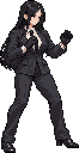

# 쟈알디 도트 규격·동작 재설계 v0.3

2026-10-19. **기획 및 단일 샘플 단계이며 기존 플레이 시연판에 적용된 명세가 아니다.** 사용자가 늘씬한 체형을 철회하고 일반 체형·충분한 매스·큰 캐릭터 픽셀을 요청한 것을 반영한다. 이 명세의 신규 제작 목표는 과거 160px 늘씬한 체형 목표보다 우선한다. 기존 원본과 게임 파일은 이전 구현 기록으로 남긴다.

## 1. 이전 구현에서 실제로 빠진 것

| 항목 | 이전 기획 | 현재 시연판의 실제 구현 | 재제작 원칙 |
| --- | --- | --- | --- |
| 근접 공격 | 타격별 6~10장 및 힘 전달 | 1·2·3타 각각 4장 | 10·12·16장, 예비·타격·회수 별도 제작 |
| 걷기 | 8~12장, 시작·정지 포함 | 루프 6장, 시작·정지 동작 없음 | 루프 12장 + 시작 6장 + 정지 6장 |
| 회피 | 전용 이동과 복귀 | 달리기 2프레임 공유 | 준비 4장 + 이동 6장 + 복귀 6장 |
| 가드 | 진입·유지·충격·해제 | 가드 1장 | 각 상태를 별도 제작 |
| 점프 | 준비·도약·상승·정점·낙하·착지 | 상승·정점·낙하·착지 각각 1장, 도약 준비 없음 | 6·4·2·4·6장으로 분리 |
| C·S | 고유 능력과 필살기 본체 | 장타 재사용, 컷인은 앞차기 확대 | C 14장·S 본체 24장·별도 컷인 12장 |
| 무게와 연결 | 지지발·체중 이동·연결 검수 | 일부 개별 포즈와 거리 위상만 연결 | 공격별 힘 전달, 상태 사이 중간 자세, 타격 반응을 함께 제작 |

프레임 수를 적어 둔 뒤 적은 그림으로 대체하고 완료 처리한 차이가 있었다. 이번 표는 구현 수량과 대조하는 제작 예산이다. 자동 완주·입력 시험을 통과해도 시각 품질을 합격으로 기록하지 않는다. 이 문서의 수치는 던전앤파이터의 실제 원본 프레임 수를 주장하는 것이 아니라 본 프로젝트의 제작 기준이다.

## 2. 픽셀과 매스 기준

처음 언급한 원본 112px·표시 224px는 초안이었다. 얼굴과 손의 표현 면적을 함께 확보하기 위해 **원본 인물 높이 128px, 화면 표시 256px, 정수 2배**로 정한다. 기존 160px 표시보다 높이는 60% 커진다. 표시 면적은 같은 실루엣일 때 약 2.56배이며, 일반 체형으로 폭도 확보하므로 실제 면적은 샘플에서 다시 측정한다.

| 항목 | 새 목표 |
| --- | --- |
| 실제 몸 높이 | 머리 꼭대기~신발 바닥 128px (대기·굽힌 자세는 자연히 작아짐) |
| 게임 내 기준 표시 높이 | 정자세 256px = 원본 2배 |
| 체형 | 약 6등신, 머리를 소폭 과장한 성인 여성, 충분한 흉곽·복부·골반·허벅지·전완 볼륨 |
| 머리 높이 | 원본 약 21~22px → 표시 약 42~44px |
| 머리 폭 | 원본 약 16~18px (머리카락 폭과 구분) |
| 어깨 폭 | 원본 32~35px → 표시 64~70px |
| 흉곽·허리·골반 폭 | 원본 27~31 / 23~27 / 26~29px |
| 위팔·전완 두께 | 원본 7~9 / 6~8px |
| 허벅지·종아리 두께 | 원본 9~11 / 7~9px |
| 손·발 | 원본 손 약 9×10px, 신발 약 12×6px부터 검토 |
| 일반 작업 셀 | 128×160px, 발 기준점 (64,144) |
| 뻗는 공격 작업 셀 | 192×160px; 큰 동작은 256×192px |
| 필살기 별도 컷인 | 상반신 위주 192×128px, 표시 2배부터 검토 |
| 본체 팔레트 | 64색 목표, 필요할 때 96색까지. 투명 포함 실제 색 수 기록 |
| 검수 크기 | 원본 1배, 게임 2배, 실제 모바일 축소 |

셀 크기는 그림을 그리는 여유 공간이다. 인물을 셀 전체로 늘리는 규칙이 아니다. 배포 시 투명 여백을 잘라 저장하고 발 기준점·오프셋을 유지한다. 도트 수를 늘린 고해상도 그림을 작게 축소하는 방식보다 원본 128px에서 명암 덩어리와 실루엣을 먼저 성립시킨다.

정자세의 해부학적 가이드는 머리 0~22, 어깨 y≈28, 허리 48, 골반 63, 사타구니 69, 무릎 100, 발목 122, 발바닥 128이다. 이는 신규 일반 체형의 출발 가이드이며 특정 포즈의 숨겨진 관절을 정확히 실측했다는 뜻이 아니다. 팔다리를 늘이거나 줄이는 보정으로 가이드에 억지로 맞추지 않는다. 장갑·구두·재킷에 게임용 실루엣 여유를 줄 수 있지만 큰 머리·짧은 사지의 SD 체형으로 바꾸지 않는다.

머리는 소폭 과장한다. 6.5등신 초안보다 얼굴의 표현 면적을 확보하되 큰 머리와 짧은 사지로 가지 않는다. 첫 샘플에서 하체에 매스가 몰린 사용자 피드백을 반영해 허벅지 폭을 약 10% 줄이고 흉곽·복부·위팔·전완을 보강한다. 가슴 크기나 어깨 폭만 과장하지 않는다. 손도 첫 샘플보다 약 10~15% 키워 장타·가드의 손 모양이 읽히게 하며 손목·전완 연결을 함께 조정한다.

옷의 질감은 큰 밝음·중간·어둠 면과 소수의 주름으로 잡는다. 검은 옷의 표면에 가는 선을 무수히 넣지 않는다. 어깨·팔꿈치·가슴 아래·골반·무릎의 형태 변화에 맞춰 명암이 따라가게 한다. 붉은 눈·흰 셔츠·넥타이·장갑·긴 검은 머리라는 식별점은 유지한다.

### 화면 및 배경

- 화면 기준은 현행 1280×720을 유지한다. 원본 배경 640×360의 2배 도트와 캐릭터 128px의 2배 도트를 맞춘다.
- 일반 문 표시 높이 약 320~350px, 책상 110~130px, 의자 좌판 70~85px에서 새 인물과 함께 검토한다. 배경 소품을 현재 그림에 그대로 둔 채 인물만 크게 만들지 않는다.
- 적도 같은 픽셀 밀도를 사용한다. 일반 성인 적은 약 224~272px, 큰 개체는 별도 체격으로 설계한다. 플레이어만 커져 적이 장난감처럼 보이는 결과를 피한다.
- 얕은 원근의 벨트스크롤 장면을 우선한다. 깊이 정렬과 접촉 그림자로 앞뒤를 표현하고, 동일 인물을 y위치마다 1.93배·2.07배 등으로 재확대하지 않는다. 방 전체에서 정수 2배의 픽셀 선명도를 유지한다. 다른 배율은 별도의 화면 구성 검토 대상으로 둔다.
- 모바일에서 캔버스 전체가 축소되는 것은 별도 문제다. 가로 390px에서 1280px 장면을 맞추면 인물의 CSS 표시 높이는 약 78px다. 원본을 128px로 정했다고 작은 패널에서 얼굴 전체가 크게 보인다고 주장하지 않는다. 가로 화면과 패널 최대 크기에서도 확인한다.

### 단일 포즈 샘플

- 원본: `game-src/action/normal-v3/sample-source.png`. 상하체 볼륨 조정 후 양손을 소폭 확대하는 이미지 편집을 반영했다.
- 게임용 샘플: `release/demo/samples/jyaldi-normal-native.png` — **66×128px, 실제 53색, 2,353바이트**.
- 표시 비교: `release/demo/samples/jyaldi-normal-2x.png` — **132×256px**, 동일 원본을 정수 2배로 표시한다.
- 비교 페이지: `release/demo/samples/jyaldi-normal-preview.html`. 원본과 2배 표시를 나란히 확인한다.
- 재현: `python3 tools/action_sample.py`. 원본 지문을 검사하고 전체에 같은 축소 배율·팔레트 패킹만 적용한다. 몸의 부위를 늘이거나 줄이지 않는다.
- 샘플은 일반 체형 후보 한 포즈다. 전체 동작 완성·사용자 최종 승인·이전 게임에 적용된 상태로 취급하지 않는다. 표의 신체 수치는 새 포즈의 검토 가이드이며 이미지를 그 수치에 강제로 변형하는 자동 규칙이 아니다.

## 3. 프레임의 뜻과 합계

아래 숫자는 **각 클립 안에서 제작할 서로 다른 그림의 예산**이다. 클립끼리 같은 끝 포즈를 참조할 수 있으므로 전체 합계는 클립 간 중복 제거 전 수량이다. 한 그림을 4틱 유지했다고 4장으로 세지 않는다. 같은 끝 포즈를 두 클립이 참조하면 런타임 저장은 한 장만 할 수 있으며, 실제 중복 제거량은 제작 후 별도로 기록한다. 최종 고유 그림 수가 아래 합계와 다르면 변경 근거와 매핑을 남긴다.

- 범용 전체 목록: **75동작, 중복 제거 전 601장**.
- 한 방 전투 품질 기준인 필수 세트: **45동작, 326장**. 본체 314장 + 별도 필살기 컷인 12장이다.
- 탐색·본부·확장 세트: **30동작, 275장**.
- 모든 요원에게 75종을 기계적으로 지급하지 않는다. 잡기 등은 지급 여부가 확정된 인물만 제작하고, 각 인물의 기본 공격·능력·실루엣을 따로 만든다.
- 이번 샘플 한 장은 이 326장 세트를 구현했다는 의미가 아니다. 다음 플레이 시연판에 적용할 때 실제 확보한 고유 그림 수와 연결 상태를 함께 공개한다.

### 대기·이동

| 동작 ID | 동작 | 고유 그림 예산 | 범위 | 필수 표현 |
| --- | --- | ---: | --- | --- |
| `idle_relaxed` | 비전투 대기 | 6장 | 확장 | 호흡·어깨·머리카락의 시간차 |
| `idle_combat` | 전투 대기 | 8장 | 필수 | 양발 체중 배분·호흡·손의 긴장 |
| `ready_enter` | 전투 자세 진입 | 6장 | 필수 | 발 재배치→무릎 하강→손 준비 |
| `ready_exit` | 경계 해제 | 4장 | 확장 | 무게중심과 손을 풀기 |
| `turn_ground` | 지상 방향 전환 | 6장 | 필수 | 지지발→골반→어깨→머리 순서 |
| `walk_start` | 걷기 시작 | 6장 | 필수 | 중심 선행·첫 디딤 |
| `walk_loop` | 걷기 한 주기 | 12장 | 필수 | 좌우 각각 접지·압축·통과·상승 |
| `walk_stop` | 걷기 정지 | 6장 | 필수 | 제동발·골반 감속·상체 복귀 |
| `step_back` | 경계 뒤걸음 | 8장 | 필수 | 적을 보며 지지발 교대 |
| `strafe` | 바닥 앞뒤 이동 | 8장 | 필수 | 전투 방향 유지·골반 이동 |
| `run_start` | 달리기 시작 | 6장 | 필수 | 전경 자세·강한 첫 추진 |
| `run_loop` | 달리기 한 주기 | 12장 | 필수 | 착지·압축·추진·체공 |
| `run_stop` | 달리기 급정지 | 8장 | 필수 | 제동발·무릎 압축·머리카락 관성 |
| `run_turn` | 달리기 반전 | 8장 | 확장 | 감속→딛기→방향 전환 |
| `evade_enter` | 회피 준비 | 4장 | 필수 | 중심 낮춤·지지발 추진 |
| `evade_travel` | 회피 이동 | 6장 | 필수 | 고유 낮은 자세·이동 궤적 |
| `evade_recover` | 회피 복귀 | 6장 | 필수 | 제동→상체 복귀→다음 행동 |

### 점프·낮은 자세·방어

| 동작 ID | 동작 | 고유 그림 예산 | 범위 | 필수 표현 |
| --- | --- | ---: | --- | --- |
| `jump_takeoff` | 점프 준비·도약 | 6장 | 필수 | 무릎 압축→발목 추진→이륙 |
| `jump_rise` | 점프 상승 | 4장 | 필수 | 다리 회수·옷의 지연 |
| `jump_apex` | 점프 정점 | 2장 | 필수 | 상승에서 낙하로 자세 전환 |
| `jump_fall` | 낙하 | 4장 | 필수 | 무릎·발목 착지 준비 |
| `land_soft` | 보통 착지 | 6장 | 필수 | 발 접촉→압축→복귀 |
| `land_heavy` | 강한 착지 | 8장 | 확장 | 큰 압축·회복 지연 |
| `crouch_enter` | 앉기 진입 | 4장 | 필수 | 고관절과 무릎 함께 굽힘 |
| `crouch_hold` | 앉기 유지 | 3장 | 필수 | 낮은 중심·작은 호흡 |
| `crouch_exit` | 일어서기 | 4장 | 필수 | 발 지지→골반 상승→상체 |
| `guard_enter` | 가드 준비 | 4장 | 필수 | 보호 위치로 팔·어깨 정렬 |
| `guard_hold` | 가드 유지 | 3장 | 필수 | 방어 방향·긴장 유지 |
| `guard_hit` | 가드 충격 | 6장 | 필수 | 충격 흡수→뒤꿈치 버팀→재정렬 |
| `guard_break` | 가드 붕괴 | 8장 | 필수 | 팔 벌어짐·중심 손실·빈틈 |
| `guard_exit` | 가드 해제 | 4장 | 필수 | 이동·공격 대기로 연결 |

### 공격·능력

| 동작 ID | 동작 | 고유 그림 예산 | 범위 | 필수 표현 |
| --- | --- | ---: | --- | --- |
| `melee_1` | 근접 1타: 장타 | 10장 | 필수 | 디딤→골반 전달→손바닥 타격→회수 |
| `melee_2` | 근접 2타: 팔꿈치 제압 | 12장 | 필수 | 반대 체중 이동·몸통 회전·다른 궤도 |
| `melee_3` | 근접 3타: 근거리 파괴 충격 | 16장 | 필수 | 강한 디딤→손 고정→능력 방출→반동 |
| `melee_end` | 연계 중단·복귀 | 6장 | 필수 | 1·2타 종료점별 자연스러운 회수 |
| `draw_pistol` | 권총 뽑기 | 6장 | 필수 | 허리→손→조준 접점 |
| `aim_pistol` | 조준 유지 | 3장 | 필수 | 손목·팔·총구 축 유지 |
| `fire_pistol` | 발사·반동·복귀 | 6장 | 필수 | 발사 이벤트→손목·팔꿈치 반동→재조준 |
| `holster_pistol` | 권총 수납·근접 전환 | 6장 | 필수 | 총과 손을 정리하며 접근 자세로 |
| `reload_pistol` | 재장전 | 12장 | 확장 | 탄창·양손·총의 접점 |
| `dash_attack` | 달리기 공격 | 12장 | 확장 | 접근 관성→제동 타격→회수 |
| `jump_attack` | 공중 근접 공격 | 10장 | 확장 | 공중 회전·반동·착지 연결 |
| `air_fire` | 공중 권총 사격 | 8장 | 필수 | 전용 하체 균형·반동 |
| `ability_quick` | C: 짧은 파괴 능력 | 14장 | 필수 | 고유 준비→방출→반작용→회수 |
| `ability_charge` | 능력 집중·유지 | 8장 | 확장 | 출력 상승·유지 루프 |
| `ability_release` | 집중 파괴 방출 | 16장 | 확장 | 큰 출력·상체 반동·회수 |
| `ultimate_body` | S: 필살기 본체 | 24장 | 필수 | 준비·집중·방출·반동·회복의 전용 동작 |
| `grab_start` | 붙잡기 진입 | 8장 | 확장 | 손과 대상 접점; 쟈알디 지급 여부 별도 |
| `grab_hold` | 포획 유지 | 3장 | 확장 | 체격 차이별 접점 |
| `throw_release` | 밀어내기·투척 | 12장 | 확장 | 발→골반→어깨→대상 힘 전달 |

### 피격·다운·회복

| 동작 ID | 동작 | 고유 그림 예산 | 범위 | 필수 표현 |
| --- | --- | ---: | --- | --- |
| `hurt_light` | 약한 피격 | 5장 | 필수 | 맞은 부위 반응·짧은 회수 |
| `hurt_heavy` | 강한 피격 | 8장 | 필수 | 중심 이동·발 밀림·회복 |
| `hurt_air` | 공중 피격 | 6장 | 필수 | 중심 잃음·낙하 전환 |
| `knockdown` | 넘어짐·추락 | 10장 | 필수 | 균형 상실→몸 회전→바닥 접촉 |
| `down_hold` | 다운 유지 | 2장 | 필수 | 바닥에 닿은 몸·잔여 움직임 |
| `getup` | 기상 | 12장 | 필수 | 손→무릎→발 순서로 체중 지지 |
| `getup_quick` | 빠른 기상·탈출 | 10장 | 확장 | 짧은 탈출 이동·중심 회복 |
| `item_use` | 아이템 사용 | 8장 | 확장 | 손동작·사용 완료 이벤트 |
| `exhausted` | 작전 지속 불가·후송 대기 | 10장 | 확장 | 힘이 풀리는 과정·영구 사망과 구분 |

### 탐색·본부·대화

| 동작 ID | 동작 | 고유 그림 예산 | 범위 | 필수 표현 |
| --- | --- | ---: | --- | --- |
| `interact_hand` | 문·패널 조작 | 8장 | 확장 | 손과 손잡이·버튼 접점 |
| `pick_up` | 물건 회수 | 10장 | 확장 | 골반·무릎 굽힘·손 도달 |
| `inspect` | 조사·확인 | 6장 | 확장 | 시선·손·짧은 멈춤 |
| `talk_gesture` | 대화 몸짓 | 8장 | 확장 | 고개·눈·손의 작은 변화 |
| `adjust_gloves` | 장갑 정리 | 10장 | 확장 | 양손 접점·쟈알디의 준비 습관 |
| `return_react` | 귀환·긴장 해제 | 8장 | 확장 | 호흡·어깨·자세 이완 |
| `carry` | 물건 운반 | 12장 | 확장 | 하중에 맞는 팔·보행 |
| `sit_down` | 의자에 앉기 | 10장 | 확장 | 의자·골반·발 접점 |
| `sit_idle` | 앉아서 대기 | 6장 | 확장 | 상체 호흡·체중 이동 |
| `stand_up` | 의자에서 일어나기 | 10장 | 확장 | 앞으로 중심 이동→발로 추진 |
| `desk_work` | 서류·업무 | 8장 | 확장 | 책상·손·문서 접점 |
| `drink` | 음료 마시기 | 10장 | 확장 | 컵·손·입의 접점 |

### 투입·철수·시네마틱

| 동작 ID | 동작 | 고유 그림 예산 | 범위 | 필수 표현 |
| --- | --- | ---: | --- | --- |
| `deploy_body` | 투입 본체 동작 | 12장 | 확장 | 착지·장비 확인·전투 자세 연결 |
| `retreat_body` | 철수 본체 동작 | 10장 | 확장 | 뒤 확인·방향 전환·이탈 |
| `evacuate_body` | 후송 상호작용 | 12장 | 확장 | 부상 자세·구조자 접점 |
| `ultimate_cutin` | 필살기 별도 컷인 | 12장 | 필수 | 전용 상반신·눈·손·머리카락 움직임 |

## 4. 공격 동작의 내부 프레임·시간 배분

| 동작 | 예비 동작 | 타격·발동 | 회수 | 고유 그림 합계 | 기본 시간 |
| --- | --- | --- | --- | ---: | ---: |
| 근접 1타 | 3장 / 90ms | 2장 / 40ms | 5장 / 170ms | 10장 | 300ms |
| 근접 2타 | 3장 / 100ms | 2장 / 50ms | 7장 / 210ms | 12장 | 360ms |
| 근접 3타 | 5장 / 150ms | 3장 / 70ms | 8장 / 300ms | 16장 | 520ms |
| 권총 발사 | 1장 / 30ms | 1장 / 20ms | 4장 / 190ms | 6장 | 240ms |
| C 짧은 능력 | 4장 / 140ms | 3장 / 70ms | 7장 / 270ms | 14장 | 480ms |
| S 본체 | 8장 / 300ms | 4장 / 120ms | 12장 / 480ms | 24장 | 900ms |

시간은 첫 플레이 검증용 시작값이다. 각 구간에 같은 시간을 균등 배분하지 않고, 예비·가속·접촉 포즈·회수에 다른 유지 시간을 준다. 준비 후 타격으로 빠르게 뻗고, 회수와 반동에서 무게를 보여 준다. 설정된 시간 안에서 개별 프레임의 유지 시간을 조정한다. 히트스톱은 위 기본 시간과 별개로 약한 명중 35~45ms, 강한 명중 60~80ms부터 검토하며 매 프레임 중복 적용하지 않는다.

- 기본 3타는 장타→팔꿈치 제압→근거리 파괴 충격으로 잡는다. 기존 앞차기 자료를 3타 능력으로 다시 부르지 않는다. 이는 게임용 기술안이며 원작 확정 기술이라고 주장하지 않는다.
- 손이 닿는 키프레임과 피해 이벤트를 연결한다. 한 공격이 같은 적에게 여러 틱 중복 명중하지 않게 한다.
- Z 유지로 연계하되 연결 창 밖의 입력을 무한 예약하지 않는다. 약 120ms 입력 버퍼와 각 공격의 명시된 연계·가드·회피 취소 창을 둔다.
- 1·2타에서 입력을 놓으면 공격별 종료 자세에서 `melee_end`의 대응 분기로 이어진다. 한 복귀 동작을 아무 종료점에나 붙이지 않는다.
- C와 S는 각각 고유 본체를 가진다. 별도 컷인 재생으로 본체 동작 부족을 가리지 않는다. 컷인 12장은 슬라이드 효과와 별도로 눈·손·머리카락·의상에 실제 변화가 있는 그림이다.

## 5. 던파 같은 동작감을 위해 함께 구현할 것

1. **힘 전달:** 뒷발 추진→골반 회전→흉곽→어깨→팔의 순서를 그린다. 타격 순간 지지발과 중심이 성립해야 한다. 상체와 하체를 독립 회전시키는 기본 처리로 대체하지 않는다.
2. **접지:** 보행 한 주기의 실제 보폭에서 이동량을 구한다. 지지 중인 발은 월드 좌표에서 거의 고정하고, 정지·반전은 제동 동작으로 이어진다. 걷기 배속으로 달리기·회피를 대체하지 않는다.
3. **반응:** 타격 때 공격자의 반동·상대의 약/강경직·다운·짧은 히트스톱을 동시에 맞춘다. 슈퍼아머는 피해를 받으면서 경직을 버티는 상태로 표현하고 정상 피격 포즈를 억지로 재생하지 않는다.
4. **후속 움직임:** 몸이 먼저 움직인 뒤 재킷·넥타이·머리카락이 따라가고, 몸이 정지한 뒤 늦게 가라앉는다. 화면 전체를 흔들어 이 시간차를 대신하지 않는다.
5. **연결:** 대기→걷기, 걷기→사격, 달리기→정지, 가드→공격, 공격 중단→대기, 다운→기상을 정상 속도로 연속 확인한다. 마지막/첫 그림을 단순 반전하거나 같은 높이로 늘려 맞추지 않는다.
6. **판정과 소켓:** 발·골반·손·총구·피격 중심을 키프레임별로 기록한다. 표시 크기가 커지면 총구 높이·근접 사거리·접촉 그림자·적 HP 표시도 새 크기에 맞춘다. 바닥의 Y축은 높이 Z축과 구분한다.
7. **검수:** 정지 포즈, 느린 재생, 정상 속도, 실제 화면, 실제 모바일 순으로 확인한다. 스크린샷과 고유 장수만으로 자연스러움을 합격 처리하지 않는다.

시뮬레이션은 60Hz를 유지하며 그림은 행동별 가변 간격으로 재생한다. 걷기 12장은 약 0.9~1.1초 주기, 달리기 12장은 약 0.75~0.95초 주기를 출발점으로 삼는다. 실제 이동 속도와 한 주기 이동량은 제작한 발 위치를 보고 함께 조정한다. 초당 60장의 서로 다른 그림을 그리는 계획이 아니다.

## 6. 용량·공용화

- 먼저 128px에서 얼굴·손·옷의 덩어리가 읽히게 만든 뒤 투명 여백 제거, 팔레트 통일, 완전히 같은 그림의 인덱스 공유, 아틀라스 패킹을 적용한다.
- 걷기를 회피로, 장타를 C·S로 돌려 쓰는 최적화는 하지 않는다. 상태 코드·마커·판정 처리·범용 이펙트와 검수 도구는 공유한다. 인체의 부자연스러운 절단·회전으로 프레임을 절약하지 않는다.
- 필수 본체 314장의 압축 PNG는 요원당 약 256~512KiB를 검토 목표로 둔다. 실제 그림을 패킹하기 전의 예산이며 보장값이 아니다. 첫 걷기·공격 묶음의 실측값을 기록해 다시 산정한다.
- PNG 용량과 디코딩 메모리를 구분한다. RGBA 1024×2048 아틀라스 한 장은 약 8MiB다. 큰 시트를 모든 인물에 대해 동시에 디코딩하지 않는다.
- 선택한 요원의 전투 자료를 로드하고, 본부의 다른 요원은 대기·생활용 작은 묶음으로 표시한다. 전투 중 지원 인물은 필요한 동작 묶음만 준비한다. 모든 인물의 완전한 시트를 한 번에 유지하지 않는다.
- 고해상도 제작 자료와 비교 이미지는 게임 HTML/팩에 포함하지 않는다. 전체 5MB 내외의 기존 다운로드 목표는 실제 합산 후 검증하며, 프레임을 정해 놓고 용량 달성을 단정하지 않는다.

## 7. 제작 순서와 범위 공개

1. 이번 일반 체형 단일 샘플을 원본 128px·표시 256px에서 확인한다. 현재 단계다.
2. 전투 대기와 걷기 12장·달리기 12장을 접지·시작·정지·반전과 함께 제작한다.
3. 근접 10/12/16장과 권총 발사 6장을 피해 판정·반동·적 피격과 결합한다.
4. 방어·회피·점프·다운·기상을 별도 상태로 연결한다. 없는 동작을 다른 행동 그림으로 임시 대체한 채 완성이라고 하지 않는다.
5. C·S 본체와 별도 컷인, 적 및 배경의 크기·픽셀 밀도를 맞춘다.
6. 필수 목록과 실제 자산/클립을 대조한 뒤 플레이 가능한 파일을 내보낸다. 덜 만든 것이 있으면 수량과 빠진 상태를 명시한다. 기능 시험과 시각 검토의 결과를 구분한다.

기획 데이터: `game-src/action/jyaldi-production-v3.json`. 현재 작동하는 이전 시연판은 이 신규 계획을 구현한 결과물로 간주하지 않는다.
