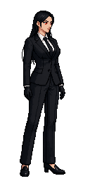
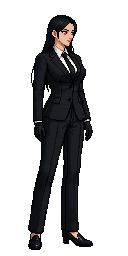

# 쟈알디 · 기준 그림과 PixelLab 변환 시험

2026-10-24 (Asia/Seoul). 적용 지침: [필드 그림 통합 지침](../../../../docs/필드_그림_통합_지침.md).

- [정면 전신 기준 그림 원본](reference/front-concept.png): GPT 생성 원본 1024×1536 PNG, 바이트 변경 없음. 원작 `assets/agents/Jyaldi_default.avif`와 `assets/portraits/Jyaldi/Jyaldi_serious.avif`를 이미지 참조로 사용했다. 도트 결과물이 아닌 고해상도 투입용 그림이다. 도구 응답까지 50.307초. GPT 생성의 차감 단위는 도구에서 제공하지 않는다.
- [변환용 캔버스](reference/front-concept-input.png): 원본에서 좌우 각 92px의 바깥 여백을 덜어내고 위아래 각 72px의 투명 여백을 추가한 840×1680 PNG. 전신의 머리·얼굴·옷·손·신발 및 신체 비율을 변형하지 않았다. 출력 128×256과 가로세로 비를 맞춘다. 원본을 덮어쓰지 않는다.
- 사용자 지시: 이 기준 그림으로 PixelLab 입력/변환 시험을 진행하고 원본을 GitHub에 보존한다. 캐릭터 8방향 등록과 애니메이션 생성은 이번 정면 변환 결과를 보여주기 전에 진행하지 않는다.
- 계획: 일반 `image_to_pixelart` 128×256, `faithful=true`, `init_image_strength=200`, 필요 시 `reduce_colors` 48색. 공식 MCP 도움말 견적 1 + 0.1 generations이며 실제 차감과 소요 시간은 `spend.log`에 기록한다.
- 기술 검수와 사용자 시각 승인은 구분한다. 실제 변환 결과를 확인하기 전에는 도트 품질·비율·투명 배경을 합격으로 보고하지 않는다. 게임에 반영된 자산이 아니다.

기존 성공 결과의 도구·요청 기록은 [남녀 페르소나 원본](../../../persona-reference-20261022/README.md)에 있다. 기존 남녀는 Pro Flash 직접 생성 결과이고 이번에는 고해상도 기준 그림의 도트 변환을 시험하므로, 같은 결과나 같은 비용을 보장하지 않는다.

## 1회 변환 결과

- [PixelLab에서 내려받은 변경 없는 원본](pixel/front-pixellab-original.png): 128×256, 38색, 회색 배경 포함(알파 전부 255). Job `bd98178d-2317-4b11-b86b-af1717e9ef7c`, Creator asset `d9e9c4d1-fa27-5165-8f11-1c75fc27f112`.
- [투명 배경 파생 파일](pixel/front-transparent.png): 외부와 연결된 정확한 RGB(128,128,128) 배경만 alpha=0으로 처리했다. 남은 인물 RGBA 픽셀은 모두 PixelLab 원본과 동일하다. 인물 경계는 x30~106, y11~243, 몸 높이 233px. 별도의 PixelLab 생성·배경 제거 호출은 없었다.
- [4배 정수 확대](pixel/front-transparent-4x.png), [기술 확인 기록](pixel/verification.json), [변환 요청 인자](pixel/conversion-request.json), [원본 생성 영수증](pixel/conversion-receipt.txt), [실측 기록](spend.log).
- 실제 차감 **1.0 generations**, 요청부터 완료 관측까지 **70.654초**(폴링·통신 포함). 생성 영수증의 차감 1회와 계정 전후 차이 1회가 일치한다. 결과가 이미 48색 이하이므로 `reduce_colors`는 실행하지 않았고 추가 0.1회 차감도 없었다.
- 상태: **사용자 반려 — 기존 남녀와 다른 도트 품질로 사용 불가.** 8방향 등록 0회, 동작 생성 0회, 게임 반영 없음. 기술 수치가 맞는 것만으로 얼굴·체형·도트 품질이 승인됐다고 판단하지 않는다. 아래 그림은 반려 기록 보존용이다.

## 2차 시험 · 외모와 도트 스타일을 분리한 Pro 이미지 생성

1차의 일반 변환은 사용자 반려 상태이므로 같은 방식으로 반복하지 않는다. 2차는 **`create_image_pro`**로 128×256 정면 도트 1장을 새로 생성한다. 기존 남녀의 Pro Flash와도 구분해서 기록한다.

- 외모 입력: 사용자가 선택한 고해상도 기준 그림. [Pro용 입력](reference/front-concept-pro-input.png)은 840×1680 입력을 비율 그대로 256×512로 축소한 참조용 PNG이며 최종 도트가 아니다. 얼굴·복식·전신 형태의 지침으로 사용한다.
- 스타일 입력: 기존 여성 도트 `gallery:4db87d5a-70bb-5169-a83d-36222e6bb9ae` 원본. `style_copy=[color_palette, outline, detail, shading]`로 도트 밀도·윤곽·명암·색감만 참고하며 단발·치마·얼굴·오른쪽 3/4 자세를 복사하지 않도록 요청했다.
- 요청: `width=128`, `height=256`, `no_background=true`, `max_colors=48`, `seed=10242027`. [전체 요청 기록](pro-style-trial/request.json), [실제 접수 응답](pro-style-trial/queue-receipt.txt).
- 접수 응답: candidate 1장, 외모 참조 1장 및 별도 스타일 참조 사용, 견적 10 generations. Job `9d30ebb3-709d-4613-8ac8-c5cd78ef2ef6`, Creator asset `b99bcd59-d54f-5b2b-a5b4-e8e7ee6758ae`.
- [PixelLab 생성 원본](pro-style-trial/front-original.png), [4배 확대](pro-style-trial/front-4x.png), [기존 남녀와 비교](pro-style-trial/comparison-4x.png), [완료 영수증](pro-style-trial/completion-receipt.txt), [기술 확인 기록](pro-style-trial/verification.json).
- 실제 결과: **128×256·48색, 알파 0/255**, 인물 경계 x31~94, y17~247, 몸 높이 231px. 내려받은 원본의 인물·배경 픽셀을 수정하지 않았다.
- 실제 차감 **10.0 generations**, 요청부터 완료 관측까지 **171.772초**(통신·폴링 포함). 영수증 10회와 계정 전후 차이 10회가 일치한다.
- 상태: **사용자가 기존 여성보다 큰 머리·짧은 목·이상한 비율을 지적한 미승인 결과**. 크기·색 수·알파 확인이 얼굴·체형·스타일의 승인을 뜻하지 않는다. 캐릭터 등록 0회, 애니메이션 생성 0회. 1차 일반 변환 1회와 합쳐 누적 차감 11회다.

## 3차 시험 · 기존 여성의 Pro Flash 생성 방식 그대로 재현

사용자가 기존 여성과 똑같이 하라고 지시했다. 이전 생성과 다른 도구·편집·변환 경로를 사용하지 않고, 기존 여성의 요청 기록을 복사했다.

- 도구: **`create_image_pro_flash`**, 입력은 **텍스트 + 기존 남성 도트 스타일 참조**(`bc8619b0-2610-53be-9470-6de218dc6b17`). 고해상도 콘셉트 이미지를 별도로 넣지 않았다.
- 원래 여성과 동일: **128×256, no_background=true, max_colors=48, seed=10222027**, 스타일 옵션 `color_palette/shading/detail/outline` 모두 true. 오른쪽 3/4·눈높이 시점·편하게 서 있는 자세·비율 지시도 같은 문장을 유지했다.
- 바꾼 것은 외모·복장 설명(쟈알디의 긴 검은 생머리·붉은 눈·성숙한 표정·풍만한 성인 체형·바지 정장·검은 넥타이·장갑)과 그에 해당하는 스타일 사용 설명뿐이다. [동일 설정 검증](flash-replay/same-settings-verification.json), [실제 요청](flash-replay/request.json).
- [수정 없는 생성 원본](flash-replay/front-original.png), [4배 정수 확대](flash-replay/front-4x.png), [기존 남녀와 같은 배율 비교](flash-replay/comparison-4x.png), [접수 응답](flash-replay/queue-receipt.txt), [완료 영수증](flash-replay/completion-receipt.txt), [파일 검증](flash-replay/verification.json).
- 실제 결과: **128×256·48색·알파 0/255**, 인물 경계 x28~92, y15~249, 몸 높이 235px. **원본 픽셀·비율·팔레트 수정 없음.**
- 실제 차감 **9.0 generations**, 요청~완료 관측 **133.816초**(통신·폴링 포함). 실제 영수증과 계정 전후 차이가 일치한다. Job `87ff5295-7f08-4430-8ef9-e5b7cda84b48`, Creator asset `f66a4343-6730-5c1a-90fb-be40a8d36511`.
- 상태: **사용자 시각 검수 대기**, 등록 0회·동작 생성 0회·게임 반영 없음. 이전 1차·2차 비용을 포함한 누적 실제 차감은 20회다. 기술 검증이나 기존 설정 재현이 자동으로 시각 승인을 뜻하지 않는다.

## 등록 준비와 실제 기존 캐릭터 확인

사용자가 3차 그림을 투입 재료로 지정하고 다음 단계를 요청했다. 등록 준비 과정에서 [정면 보완](registration-prep/front-supplement.png)을 Pro Flash로 1장 생성했다. [요청](registration-prep/front-request.json), [영수증](registration-prep/front-receipt.txt), [확인 기록](registration-prep/verification.json). 실제 9회 차감, 요청~완료 관측 125.349초였다.

그 뒤 사용자가 자신의 캐릭터는 정면 없이도 8방향을 만들었다고 지적해 실제 Test woman을 조회·다운로드했다. V3·side·8방향이며 저장된 south 원본 RGBA가 기존 오른쪽 3/4 여성 원본과 완전히 같았다. **정면 추가 생성은 등록 실행의 필수 조건이 아니었다.** 참조를 south로 가정하는 방향 기준의 문제와 API 실행 가능 여부를 구분한다. 쟈알디 캐릭터 등록·동작 생성은 아직 0회이며, 위 정면 보완을 승인된 정면으로 취급하지 않는다.

## 현재 작업용 · 이름과 붉은 눈 수정

- Creator 저장 이름: **쟈알디 | Jyaldi | 오른쪽 3/4 기준 도트 · 붉은 눈 수정본**. 갤러리 ID **`46806996-274f-44c2-83dc-e1b86f175dbe`**. 기존의 일반 설명 제목을 덮어쓴 것이 아니라 수정본을 이름이 분명한 새 갤러리 항목으로 저장하고 원본을 보존했다. 새 캐릭터 등록은 아니다.
- 도구: 무료 `pixelart_workbench edit`, 이어서 무료 `save_to_asset(target=gallery:new)`. **추가 생성 0회·추가 차감 0회**이며 계정 전후 차이도 0이었다.
- 변경: 관측한 홍채 **6픽셀만** 기대 색상 검사를 거쳐 진홍색 ramp로 수정. **나머지 모든 RGBA 픽셀·알파·형태는 동일**, 캔버스 128×256·팔레트 48색 유지. [정확한 수정 명령](red-eyes/pixel-patch.json), [픽셀별 검증](red-eyes/verification.json), [갤러리 정보](red-eyes/gallery.json), [저장 응답](red-eyes/gallery-save-receipt.txt).
- [현재 작업용 원본](red-eyes/jyaldi-right-three-quarter.png), [4배 정수 확대](red-eyes/jyaldi-right-three-quarter-4x.png), [눈 수정 전/후](red-eyes/eyes-before-after.png).
- 상태: 눈 색 수정본은 사용자 시각 검수 대상이다. 8방향 등록·동작 생성·게임 적용은 아직 없다. 정면 보완을 포함한 누적 실제 차감은 **29회**, 이번 픽셀 수정과 이름을 붙인 저장 자체는 **0회**다.

